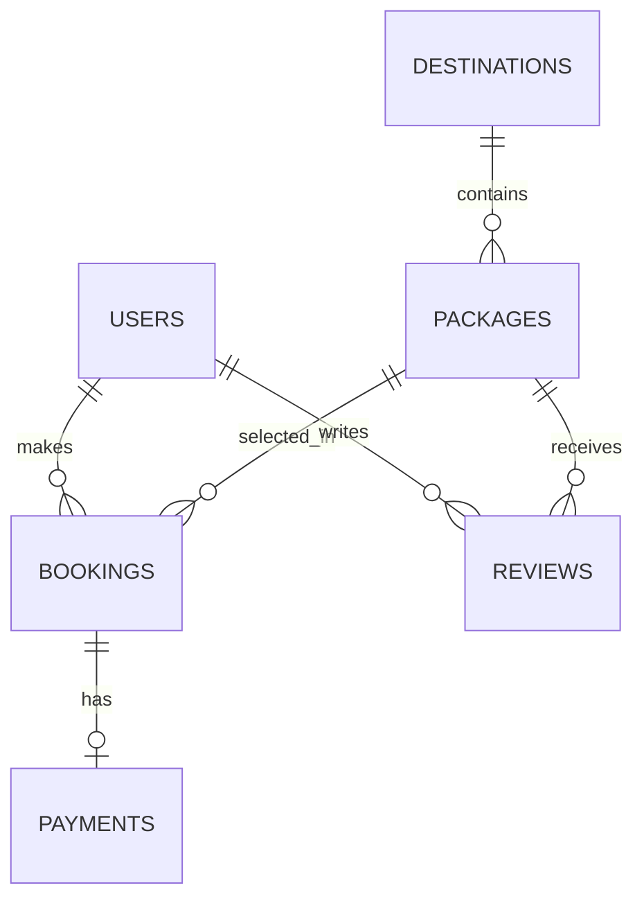

# Tourism Package Planner — DBMS Project

**Project title:** Tourism Package Planner  
**Application name:** Wanderly  
**Backend:** Python + Flask  
**Database:** SQLite (relational database)  
**Frontend:** HTML, CSS and JavaScript

A responsive tourism booking web application for exploring travel packages, registering customers, placing reservations and managing inventory from an admin dashboard.

## 1. Features

### Customer features
- Browse seeded destinations and travel packages.
- Search by destination, state, package title or description.
- Filter by destination and travel style; sort by price or duration.
- View package duration, highlights, inclusions, seasonal information and seat availability.
- Register and log in with securely hashed passwords.
- Book a package for a future travel date and select a payment preference.
- View booking confirmation and booking history.
- Cancel an eligible upcoming booking; the available seat count is restored.

### Admin features
- Dashboard summary: active packages, customers, total bookings and booking value.
- View recent reservations with customer and package details.
- Update booking status (Confirmed, Completed or Cancelled).
- Hide or show packages in the public catalogue.
- Add a new package to an existing destination.

### Database features demonstrated
- Relational schema with primary keys and foreign keys.
- `NOT NULL`, `UNIQUE`, `CHECK` and default constraints.
- One-to-many and one-to-one relationships.
- Joins across customers, bookings, packages and destinations.
- Aggregate functions (`COUNT`, `SUM`, `COALESCE`).
- Indexes for common lookup and booking queries.
- Transactional booking workflow (`BEGIN IMMEDIATE`, `COMMIT`, `ROLLBACK`) so seats and booking records stay consistent.
- Password hashing with Werkzeug.

> Payment options are demonstration-only. The application records a payment preference and a Pending status; it does not connect to a bank, UPI provider or payment gateway. Package descriptions and inclusions are sample academic data, not live travel offers.

## 2. Requirements

- macOS, Windows or Linux
- Python 3.10 or newer
- Internet connection for the first-time Flask installation
- A modern browser (Chrome, Safari, Edge or Firefox)

## 3. Run on macOS

1. Extract `Tourism_Package_Planner.zip`.
2. Open Terminal and move into the extracted folder. Example:

   ```bash
   cd ~/Downloads/tourism_package_planner
   ```

3. Create a virtual environment and install the dependency:

   ```bash
   python3 -m venv .venv
   source .venv/bin/activate
   pip install -r requirements.txt
   ```

4. Start the application:

   ```bash
   python app.py
   ```

5. Open **http://127.0.0.1:5000** in your browser.

The SQLite database is created automatically at `instance/tourism.db` on first launch. Stop the server with `Control + C` in Terminal.

### Quick start (macOS)

You can also run `./run_mac.command` from Terminal. On first run it creates `.venv`, installs Flask and starts the application. If macOS blocks the file, run:

```bash
chmod +x run_mac.command
./run_mac.command
```

## 4. Run on Windows

1. Install **Python 3.10 or newer** from https://www.python.org/downloads/windows/. During installation, tick **Add python.exe to PATH**.
2. Extract `Tourism_Package_Planner.zip` (right-click the ZIP file and choose **Extract All**).
3. Open the extracted `tourism_package_planner` folder.
4. Double-click **`run_windows.bat`**. The first run creates a virtual environment and installs Flask; this needs an internet connection.
5. When the terminal says the app is ready, open **http://127.0.0.1:5000** in Chrome or Edge.
6. Keep the terminal window open while using the project. Press **Ctrl + C** in that window to stop the server.

### Manual Windows setup (alternative)

Open Command Prompt in the `tourism_package_planner` folder (click the folder address bar, type `cmd`, and press Enter), then run these commands one at a time:

```bat
py -3 -m venv .venv
.venv\Scripts\activate.bat
python -m pip install -r requirements.txt
python app.py
```

Then open **http://127.0.0.1:5000** in your browser. If `py` is not recognized, reinstall Python and ensure the Python Launcher and **Add python.exe to PATH** options are enabled.

## 5. Demo login accounts

| Role | Email | Password |
|---|---|---|
| Customer | `demo@tourism.com` | `Demo123!` |
| Admin | `admin@tourism.com` | `Admin123!` |

You can also create a new customer account using the Register page. These credentials are for the local academic demonstration only.

## 6. Project structure

```text
tourism_package_planner/
├── app.py                 # Flask routes, business rules and DB access
├── schema.sql             # Relational database schema
├── requirements.txt       # Python dependencies
├── run_mac.command        # macOS quick-start script
├── run_windows.bat        # Windows quick-start script
├── README.md              # Setup guide and viva notes
├── instance/
│   └── tourism.db         # Created automatically on first run
├── templates/             # Jinja HTML pages
│   ├── base.html
│   ├── index.html
│   ├── packages.html
│   ├── package_detail.html
│   ├── login.html
│   ├── register.html
│   ├── my_bookings.html
│   ├── booking_success.html
│   ├── admin.html
│   ├── about.html
│   └── error.html
└── static/
    ├── css/style.css
    └── js/app.js
```

## 7. Database design

### Tables and purpose

| Table | Primary key | Purpose |
|---|---|---|
| `users` | `user_id` | Stores customer/admin accounts and password hashes. |
| `destinations` | `destination_id` | Stores destination name, state, country and season. |
| `packages` | `package_id` | Stores package details and references a destination. |
| `bookings` | `booking_id` | Stores the customer, package, date, traveler count and booking status. |
| `payments` | `payment_id` | Stores the payment preference/status for a booking. |
| `reviews` | `review_id` | Stores a customer's rating and feedback for a package. |

### Relationships



- One destination can have many packages; each package belongs to one destination.
- One customer can make many bookings; each booking belongs to one customer.
- One package can appear in many bookings; each booking refers to one package.
- Each booking can have zero or one payment record; in this project a payment preference record is created when a booking succeeds.
- A customer can review a package once because of the composite `UNIQUE(user_id, package_id)` constraint.

### Normalization overview

The design separates customer, destination, package, booking and payment data into related tables instead of repeating the same customer or destination details in every booking. Non-key attributes are stored with the entity they describe. Foreign keys connect the tables and reduce update anomalies. The design follows the core intent of **Third Normal Form (3NF)** for the stored operational data.

## 8. Important SQL queries for viva

**A. Display packages with their destination (INNER JOIN):**

```sql
SELECT p.title, d.name AS destination, d.state, p.price_per_person
FROM packages AS p
INNER JOIN destinations AS d
    ON p.destination_id = d.destination_id
WHERE p.is_active = 1;
```

**B. Count bookings for each package (LEFT JOIN + GROUP BY):**

```sql
SELECT p.title, COUNT(b.booking_id) AS total_bookings
FROM packages AS p
LEFT JOIN bookings AS b ON p.package_id = b.package_id
GROUP BY p.package_id, p.title
ORDER BY total_bookings DESC;
```

**C. Calculate booking value excluding cancelled bookings:**

```sql
SELECT COALESCE(SUM(total_amount), 0) AS booking_value
FROM bookings
WHERE status <> 'Cancelled';
```

**D. Find customers who have made at least one booking:**

```sql
SELECT DISTINCT u.full_name, u.email
FROM users AS u
INNER JOIN bookings AS b ON u.user_id = b.user_id;
```

**E. Find packages priced below the average package price (subquery):**

```sql
SELECT title, price_per_person
FROM packages
WHERE price_per_person < (SELECT AVG(price_per_person) FROM packages);
```

## 9. Suggested demo flow

1. Open the home page and explore the destination cards.
2. Open **Explore packages**, search for Manali and sort by price.
3. Open a package, select a future date and traveler count, then create a reservation.
4. Open **My bookings** and show the generated booking reference.
5. Sign out and log in as the admin.
6. Open **Admin** to show dashboard totals, recent bookings, status updates and package visibility controls.
7. Add a sample package to one of the existing destinations.
8. Open `schema.sql` or the About page to explain the tables and relationships.

## 10. Viva preparation

**What is the objective of this project?**  
To design a database-backed system where customers can explore tourism packages and reserve trips, while an administrator can manage package inventory and bookings.

**Why is a DBMS required?**  
A DBMS stores related data in an organized way, maintains relationships through keys, enforces constraints and makes searching and updating records reliable.

**What is a primary key?**  
A primary key uniquely identifies each row in a table. For example, `package_id` identifies one package.

**What is a foreign key?**  
A foreign key links one table to another. For example, `packages.destination_id` references `destinations.destination_id`.

**Why are bookings stored separately from packages?**  
One package can be booked by many customers, and each booking has its own travel date, traveler count and status. Keeping bookings in a separate table avoids repeating package data.

**Where is a JOIN used?**  
The package listing joins `packages` with `destinations`, while booking history joins `bookings`, `packages` and `destinations` to show meaningful details.

**What is normalization?**  
Normalization organizes data into related tables to reduce duplication and prevent insertion, update and deletion anomalies.

**What is a transaction in this project?**  
When a customer books, the system decreases available slots, inserts the booking and inserts the payment-preference record as one transaction. If an operation fails, the transaction is rolled back.

**Why use SQLite?**  
SQLite is a lightweight relational database that stores data in a local file and is simple to set up for a college project. The SQL concepts demonstrated are transferable to other relational DBMSs, with some syntax differences.

**Is the payment gateway real?**  
No. Payment selection is a demo field. No actual money is collected or transferred.

## 10. Reset the sample database

Stop the app, then delete `instance/tourism.db`. Start `python app.py` again. The application recreates the tables and inserts the demo records.
